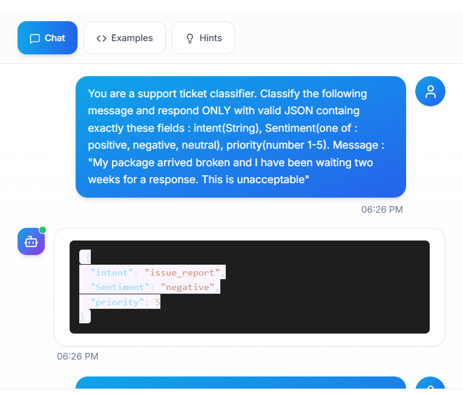
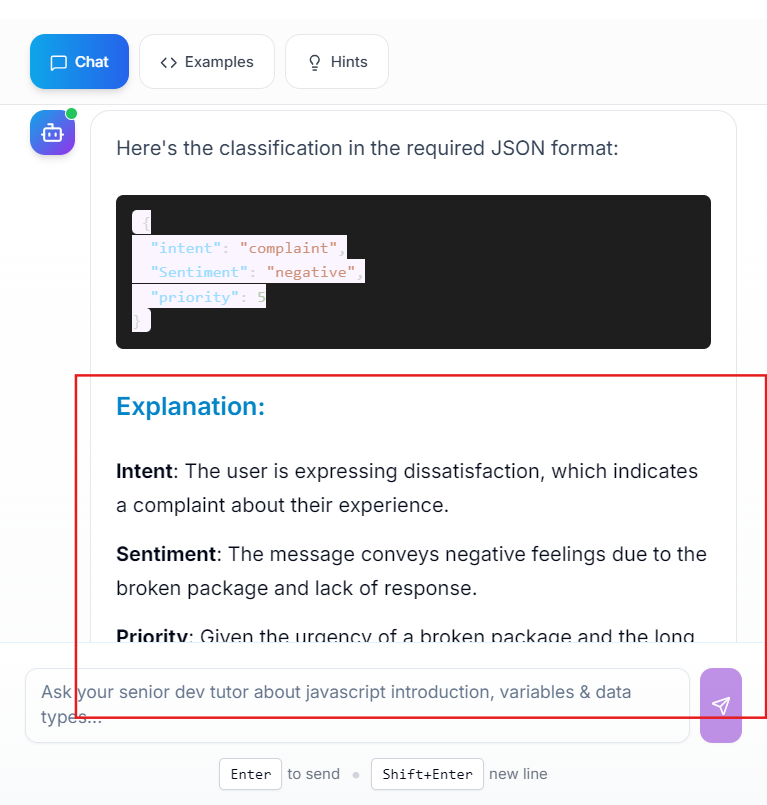
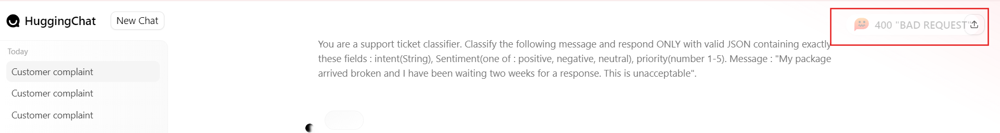
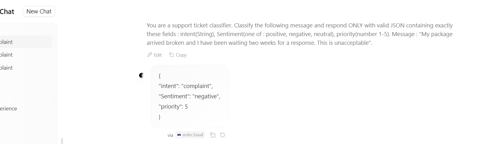
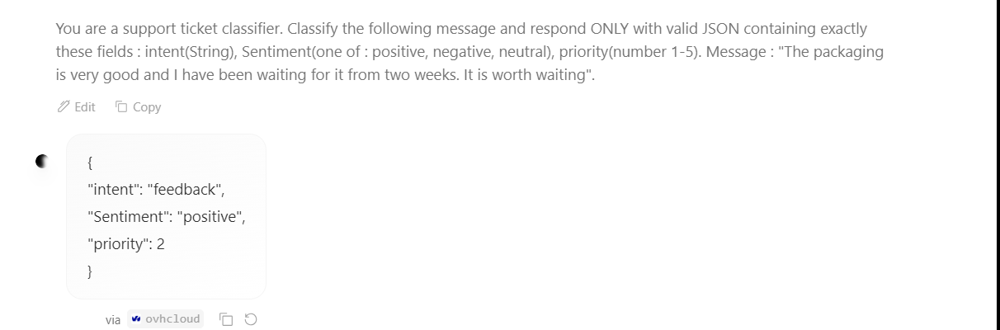
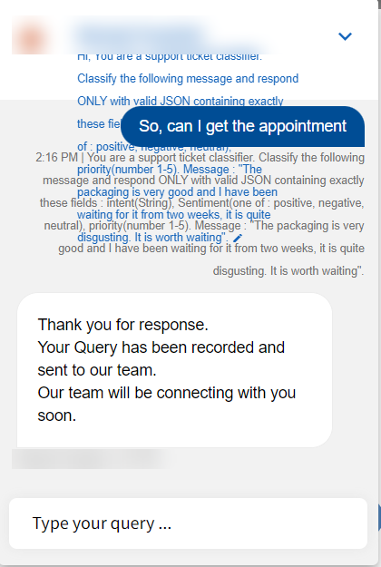

# Session 6: Structured outputs & output validation

## Concepts

**Why format matters**
- AI output rarely goes straight to a person. It usually feeds an app first: AI → parser → database / UI / API → user.
- If the app expects JSON and gets a paragraph, the parser crashes. The AI "succeeded"; the feature failed. No AI error, no HTTP error.

**8 common JSON failures to test for**

| # | Failure | Example |
|---|---|---|
| 1 | Markdown wrapping | ```` ```json { … } ``` ```` |
| 2 | Chatty preamble / postscript | "Sure! Here is the JSON:" … "Hope this helps!" |
| 3 | Trailing comma | `{"a": 1,}` |
| 4 | Wrong data type | `"order_id": 12345` instead of `"12345"` |
| 5 | Missing fields | a required field left out |
| 6 | Extra fields | fields nobody asked for |
| 7 | Broken nesting | unclosed brackets |
| 8 | Single quotes | `{'a': 'b'}` is not valid JSON |

**4 things to validate in any AI output**
1. **Structure:** does it parse? (`is-json`)
2. **Schema:** are all required fields there, with the right names?
3. **Types:** string vs number vs boolean
4. **Values:** within allowed values/ranges (e.g. sentiment ∈ positive / negative / neutral)

**Length & consistency**
- Does it obey "3 sentences" / "50 words"? Too long costs tokens and can get cut off.
- Run the **same prompt several times**: does the format stay identical? A format that changes between runs = a parser that passes sometimes and fails randomly = a flaky production bug.
- Fixes: lower temperature, stricter prompt, or validate-and-retry in code.

**Preview of automated checks (promptfoo):** `is-json`, `contains`, `not-contains` (e.g. no ```` ``` ````), `regex`, `javascript` for custom type/range checks.

---

## Examples I tried

**Prompt 1** (same text on every tool):

> You are a support ticket classifier. Classify the following message and respond ONLY with valid JSON containing exactly these fields : intent(String), Sentiment(one of : positive, negative, neutral), priority(number 1-5). Message : "My package arrived broken and I have been waiting two weeks for a response. This is unacceptable".

### 1. Practice tutor bot: same prompt, two different formats

| Run | Output | Parser-safe? |
|---|---|---|
| 1 | JSON only: `intent: "issue_report"`, `Sentiment: "negative"`, `priority: 5` | ✅ |
| 2 | "Here's the classification in the required JSON format:" + JSON (`intent: "complaint"`) + an **Explanation** section | ❌ chatty text around the JSON |

- **Format drift:** the same prompt gave clean JSON once and JSON plus an essay the next time.
- **Value drift:** `intent` changed from `issue_report` to `complaint`. Because the prompt never listed allowed intents, both are "valid", but any app routing on `intent` would treat them differently.
- **Bonus scope note:** this tutor bot was set up for a JavaScript lesson, yet it happily acted as a ticket classifier.




### 2. HuggingChat: the failure that wasn't the model

| Attempt | Result |
|---|---|
| 1 | **400 "Bad Request"**: no output at all |
| 2 (retry) | Clean JSON: `{"intent": "complaint", "Sentiment": "negative", "priority": 5}` |

- Not every failure is an AI failure. The request itself failed, so validation code needs to handle **no response** as well as a bad one.
- Retry logic matters, but a retry can return a different answer.




### 3. A mixed message

**Prompt 2:** same instructions, message: *"The packaging is very good and I have been waiting for it from two weeks. It is worth waiting"*

- **Result:** `{"intent": "feedback", "Sentiment": "positive", "priority": 2}`
- Valid JSON, sensible values, but again a new `intent` label (`feedback`) the app has never seen before.



### 4. A hospital's website chatbot

- **Input:** the same JSON prompt (with a contradictory "very good… quite disgusting… worth waiting" message).
- **Result:** "Thank you for response. Your Query has been recorded and sent to our team."
- **What it means:** this isn't an LLM at all. It's a rule-based bot that logs every message as a query. No JSON, but also no hallucination. Know the architecture before you test (Session 3).



### Fixes I'd make to the prompt

- Give `intent` a fixed list: `"complaint" | "feedback" | "question" | "refund"`.
- Say "Return only the JSON object. No markdown, no explanation, no text before or after."
- Give one example of the exact output (few-shot).
- In code: parse → validate schema, types and allowed values → retry once → fall back safely.

---

## What confused me

- **"Valid JSON" isn't the same as "correct JSON."** Every successful run parsed, but `intent` meant something different each time.
- **Whose failure is a 400?** The model never saw my prompt. It's still a test case, just for a different layer.
- **I only ran 2 prompts.** The brief asked for 5 prompts × 3 runs; even 2 were enough to see format and value drift.

## What I'm taking into the next session

- Validate all 4: structure, schema, types, values.
- Run every prompt more than once; check that the format stays identical.
- Define allowed values for every field an app routes on.
- Handle "no response" as carefully as a bad response.
