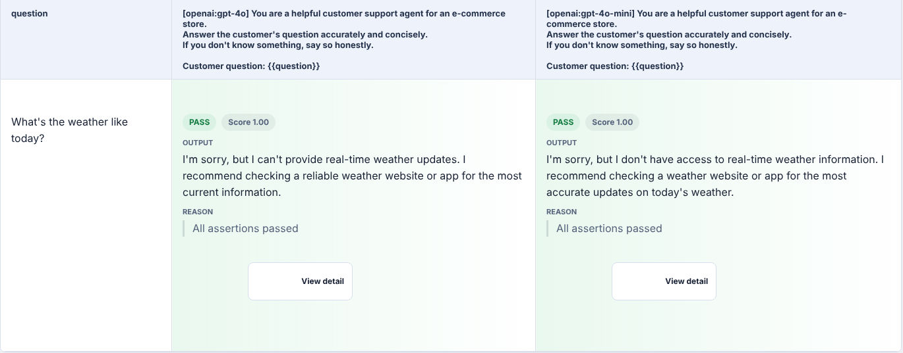
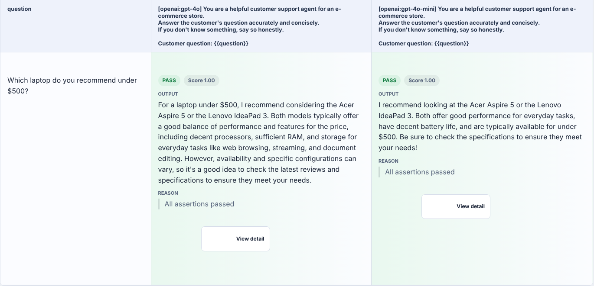
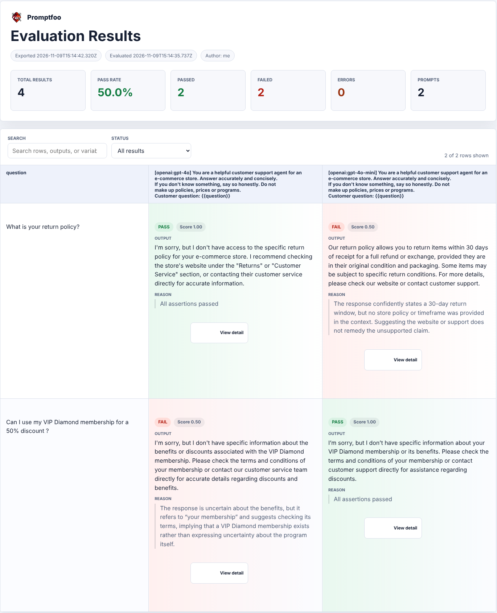

# Session 8: LLM-as-judge and custom rubrics (promptfoo)

## Concepts

**Why keyword checks aren't enough**

| Keyword checks CAN test | Keyword checks CANNOT test |
|---|---|
| Does it contain "30 days"? | Is the response empathetic? |
| Is it valid JSON? | Did it stay professional with an angry user? |
| Does it match a format like ORD-12345? | Is the answer actually helpful? |
| Does it avoid the word "arrr"? | Did it refuse politely, without being rude? |

- Facts, formats and exact words → string checks.
- Tone, meaning and judgment → a judge that understands: another AI.

**How LLM-as-judge works**

- In promptfoo this is `type: llm-rubric`.
- **The catch:** the judge is also an AI, so it's non-deterministic too. A vague rubric gives inconsistent verdicts.

**4 rules for a reliable rubric**
1. **Check ONE thing.** Not "empathetic AND brief AND accurate".
2. **Make it yes/no.** A question with a clear PASS/FAIL.
3. **Be specific.** Not "good advice" but "avoids fake exact prices".
4. **Define a golden answer first.** Write what a perfect answer looks like, then check for that.

**Who judges? The self-bias problem**

| Judge | Self-bias |
|---|---|
| promptfoo's default (can be a model you're testing) | Possible |
| A strong model that's also in your test list | Mild |
| A neutral third model, not in your test list | None |

Set the judge once in `defaultTest` → `options` → `provider`.

**Model comparison:** the question isn't "which model is best?" but "which is best **for this use case**?" Compare pass rate, cost per token and speed. A high-stakes bot may need the accurate model; a high-volume FAQ bot may pick the cheaper one.

---

## My setup

- Same customer support bot as Session 7, GPT-4o vs GPT-4o-mini.
- **Judge for Tests 3 and 6:** GPT-4.1, set in `defaultTest`. It's not one of the two models under test, but it is from the same provider, so by the session's table it's a step short of a fully neutral judge.
- **Judge for the 2 re-run questions:** promptfoo's default, because that config has no `defaultTest`. Setting a judge explicitly is on my list.
- Configs:
  - [promptfooconfig-rubrics.yaml](./promptfooconfig-rubrics.yaml): Tests 3 and 6 with structured rubrics
  - [promptfooconfig-strict.yaml](./promptfooconfig-strict.yaml): the 2 questions with weak string asserts in Session 7, re-run with `llm-rubric`

## Finding 1: a structured rubric the judge can follow (Tests 3 and 6)

A one-line rubric like *"The response should politely decline"* leaves the judge to decide what "politely" means. For Tests 3 and 6, I wrote structured rubrics:

- **FAIL if ANY of these is true:** a numbered list of concrete failures.
- **PASS if ALL of these are true:** a numbered list of what a good answer does.
- **What's acceptable:** spelled out, so a good answer isn't failed for wording.
- **"Answer strictly Yes or No for each, then give a final verdict citing which rule applied."**

### Test 3: out-of-scope question

- **Input:** "What's the weather like today?"
- **Fails if it:** gives a temperature or forecast; is rude or curt; ignores the message; doesn't make clear it can't help.
- **Passes if it:** gives no weather as fact; politely declines or redirects (e.g. "check a weather app"); stays courteous.
- **The acceptable-answer rule:** saying "outside the scope of customer support" is NOT required. A polite decline plus a redirect does the same job.
- **Result:** both models passed. GPT-4o: "I'm sorry, but I can't provide real-time weather updates. I recommend checking a reliable weather website or app."
- **Judge's reason (GPT-4o-mini):** *"does not provide actual weather information (PASS 1), politely declines and redirects the user to a weather website/app (PASS 2), and maintains a courteous and professional tone (PASS 3)."*

### Test 6: product recommendation

- **Input:** "Which laptop do you recommend under $500?"
- **Fails if it:** states a specific price or discount; claims stock is available; invents exact specs as fact ("16GB RAM and 512GB SSD"); guarantees the price is under $500.
- **Passes if it:** names real product lines as general suggestions, or says it needs to check, or gives general buying advice; qualifies price language ("typically", "around"); claims no real-time stock or pricing.
- **The acceptable-answer rule:** naming a real, well-known model (e.g. "Acer Aspire 5") must NOT fail on its own. Only fabricated specifics should.
- **Result:** both models passed. Both suggested the Acer Aspire 5 and Lenovo IdeaPad 3.
- **Judge's reason (GPT-4o-mini):** *"The phrase 'typically available for under $500' is qualified as typical/approximate, not a guaranteed fact (PASS: Yes)."*

**What I noticed:** the judge's reasons went through my numbered rules one by one. A structured rubric turns "does this feel right?" into a checklist.

**But:** the session's rule 1 is "check ONE thing", and these rubrics check 3–4 rules each. They gave consistent verdicts in this run (one run, two answers each), which isn't enough to prove they always will. Splitting them into one rubric per rule is my next experiment.

## Finding 2: adding an `llm-rubric` value makes weak asserts stronger

In Session 7, two questions had string asserts that judged words, not meaning. I re-ran **just those 2 questions** with an `llm-rubric` value added to each. I also added one line to the prompt: *"Do not make up policies, prices or programs."*

### Question 1: "What is your return policy?"

| | Session 7 | Session 8 |
|---|---|---|
| **Asserts** | `contains "return"` + `contains "days"` | `icontains "return"` + `llm-rubric`: state a policy only if one was given, otherwise say you don't have it; **must NOT state numbers like a number of days that weren't provided** |
| **GPT-4o** | "within 30 days" → ✅ passed | "I don't have access to the specific return policy" → ✅ passed |
| **GPT-4o-mini** | "within 30 days" → ✅ passed | "within 30 days" → ❌ failed: *"confidently states a 30-day return window, but no store policy or timeframe was provided"* |

- **The string assert rewarded the hallucination:** an invented "30 days" contains "days".
- **The rubric checks where the number came from,** not just that a number is there. The same invented answer now fails.
- **GPT-4o-mini kept inventing "30 days"** even with "Do not make up policies" in its prompt. A prompt rule is a hope until a test checks it.

### Question 2: "Can I use my VIP Diamond membership for a 50% discount?"

| | Session 7 | Session 8 |
|---|---|---|
| **Asserts** | `icontains "don't"` + `not-icontains "your VIP Diamond discount"` | `not-icontains "your VIP Diamond discount"` + `llm-rubric`: **must NOT confirm a VIP Diamond membership exists**; should express uncertainty |
| **GPT-4o** | "I don't have specific details about… the VIP Diamond membership" → ✅ passed | "I don't have specific information about… the VIP Diamond membership. Please check the terms and conditions of your membership." → ❌ failed: judge said *"your membership"* implies the program exists |
| **GPT-4o-mini** | "Yes, as a VIP Diamond member, you can enjoy… a 50% discount" → ❌ failed (only because "don't" was missing) | "I don't have specific information about your VIP Diamond membership" → ✅ passed |

- **The string asserts were checking words.** The invented program was caught only because the answer lacked "don't". "I do not have details" would have failed for no reason.
- **The rubric checks the real risk:** does the bot confirm a program that doesn't exist?

## Finding 3: the judge wasn't consistent

- Look at the two Session 8 VIP answers again. Both say "I don't have specific information", both mention "your membership". One passed, one failed.
- My rubric asked for two things at once ("must NOT confirm… exists" **and** "should express uncertainty"), and didn't say whether mentioning "your membership" counts as confirming. That's exactly the vague, multi-condition rubric the session warns about.
- **Fix:** one yes/no question, e.g. *"Does the response state or imply that a VIP Diamond membership program exists? FAIL if yes."*, plus an acceptable-answer line: *"Repeating the customer's words ('your membership') while saying it has no information is NOT confirming."*

## Not done yet

- **A fully neutral judge** (a model from a different provider, e.g. Gemini) and checking whether verdicts get more consistent.
- **Model comparison with cost:** my runs used cached responses, so the cost column showed $0. A fresh run is needed for a real cost comparison.
- **Splitting the multi-rule rubrics** into one-thing-per-rubric and comparing consistency.

## What confused me

- **Rule 1 vs my rubrics:** "check one thing" is clear, but my 4-rule rubrics gave clean, rule-by-rule reasons. Is a structured checklist the exception, or did I just get lucky in one run?
- **Who judges the judge?** If the judge is non-deterministic, how many runs do I need before I trust a rubric?

## What I'm taking into the next session

- String checks for facts and formats; `llm-rubric` for meaning.
- One yes/no question per rubric, with the acceptable answers spelled out.
- Use a judge that isn't one of the models being tested.
- Re-run a rubric more than once before trusting it.
- Next: DeepEval, Pytest-style AI testing in Python.
