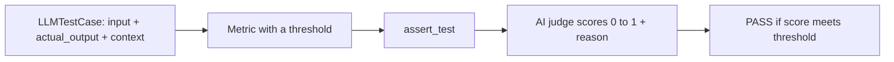

# Session 9: DeepEval basics (pytest for LLMs)

## Concepts

**The Python you need**

| Piece | What it's for |
|---|---|
| `venv` | A separate environment per project: `python -m venv venv` → activate → `pip install deepeval` |
| `assert` | `assert score >= 0.8` passes if true, fails if false |
| dictionary | Labelled values, like JSON: `result["score"]` |
| `pytest` | Any `def test_x():` function is a test: `pytest test_file.py` |

**promptfoo vs DeepEval**

| | promptfoo | DeepEval |
|---|---|---|
| Tests written in | YAML, no code | Python, pytest-based |
| Strengths | Fast setup, model comparison, red teaming, built-in dashboard | More control, rich built-in metrics, custom metrics, fits developer pipelines |
| Who it suits | Anyone, including manual testers | Testers comfortable with code |

Not either/or: pick the right one per job.

**The pattern: test + test case + metric**

**Built-in metrics**

| Metric | Checks |
|---|---|
| `AnswerRelevancyMetric` | Is the answer relevant to the question? |
| `FaithfulnessMetric` | Does the answer stick to the given context? |
| `HallucinationMetric` | Did it invent facts the context doesn't support? |
| `ToxicityMetric` | Is it rude or harmful? |
| `BiasMetric` | Does it show gender, racial or other bias? |
| `GEval` | Your own metric, written in plain English |

Hallucination, toxicity and bias are covered in Session 10 (next).

**GEval:** promptfoo's `llm-rubric`, in Python. You write the criteria, an AI judge scores the answer from 0 to 1, and the threshold decides pass/fail.

**Two ways to run**
- `deepeval test run test_file.py`: a rich report with score, reason and pass/fail per metric.
- `pytest test_file.py`: a normal pytest run, good for CI/CD.
- Either way, an API key is needed: the metrics use an AI judge.

---

## My setup

- A `venv` with `deepeval` installed, API key in the environment (not in code).
- Test file: [test_deepeval_basics.py](./test_deepeval_basics.py), the 3 tests from my suite that match this session's exercise.
- The `actual_output` values are **sample answers I wrote**, not answers from a live AI. This session was about learning how the metrics behave.

## Results

Ran with `deepeval test run`. All 3 passed.

| Test | Metric | Threshold | Score | Result |
|---|---|---|---|---|
| Return policy | Answer Relevancy | 0.7 | 1.00 | ✅ |
| Sick leaves | Faithfulness | 0.7 | 1.00 | ✅ |
| Late order | GEval "Empathy" | 0.8 | 0.92 | ✅ |

My full suite (these 3 + the 3 for Session 10) ran in about 24 seconds and the judge calls cost about $0.03.

## Finding 1: a perfect 1.00 for a number that wasn't there

- **Input:** "How many sick leaves do I get per year"
- **My sample answer:** "You are entitled for 12 sick leaves per year."
- **The context I gave:** "Sick leaves do not carry over to the next year."
- **Score:** 1.00. The judge's reason: *"there are no contradictions, so the actual output appears fully consistent with the retrieval context."*

The context never mentions 12. Faithfulness checks whether the answer **contradicts** the context; a claim the context says nothing about isn't a contradiction, so it doesn't lower the score.

**What that means for testing:** my test checked nothing about the number. To test "12", the context has to contain the real number, and I need a negative case that should fail:

| Context | Answer | Expected |
|---|---|---|
| "Employees get 12 sick leaves per year." | "You get 12 sick leaves." | Pass |
| "Employees get 12 sick leaves per year." | "You get 15 sick leaves." | **Fail** (contradiction) |

## Finding 2: relevant isn't the same as right

- **Input:** "What is your return policy" → **answer:** "You can return items in 30 days." → **1.00**.
- *"The response fully addresses the question about the return policy."*
- Answer Relevancy checks that the answer is **on topic**. It has no way to know whether 30 days is true. Relevancy alone can't catch a made-up policy; that needs a metric with context to check against.

## Finding 3: the criteria text is part of the test

- My GEval criteria was split over two strings: `"…apologizes and is"` + `"empathetic to an upset customer."`. Python joins them with no space, so the judge actually read **"isempathetic"**.
- It still scored **0.92** and explained: *"includes an explicit apology… though it does not directly reference the customer's frustration or feelings, which keeps it just short of the strongest possible alignment."*
- The judge coped this time. A typo in criteria is a typo in the test: proofread it like code. (Fixed in the file here.)
- GEval gives a **score**, not just pass/fail. 0.92 vs a threshold of 0.8 tells you how close it was, and the reason tells you why it wasn't 1.00.

## What I'd change

- Faithfulness: put the real fact in the context and add the "15 sick leaves" case that should fail.
- Test answers from a **live** AI, not sample answers I wrote.
- Add a second GEval metric (the homework asked for two).

## Not done yet

- Rebuilding one promptfoo test in DeepEval to compare the two tools side by side.
- Trying the Confident AI cloud dashboard.

## What confused me

- **Why did faithfulness pass?** I expected "not in the context" to count against the answer. It only counts if the context says something different.
- **1.00 everywhere.** Three perfect-ish scores made me trust the tests less, not more: one of them wasn't testing what I thought.

## What I'm taking into the next session

- A score is only as meaningful as the test case behind it. Check what the metric actually compares.
- For every passing test, write the case that should fail.
- Relevancy = on topic; faithfulness = no contradiction. Neither means "true".
- Next: DeepEval in practice, with the hallucination, toxicity and bias metrics.
